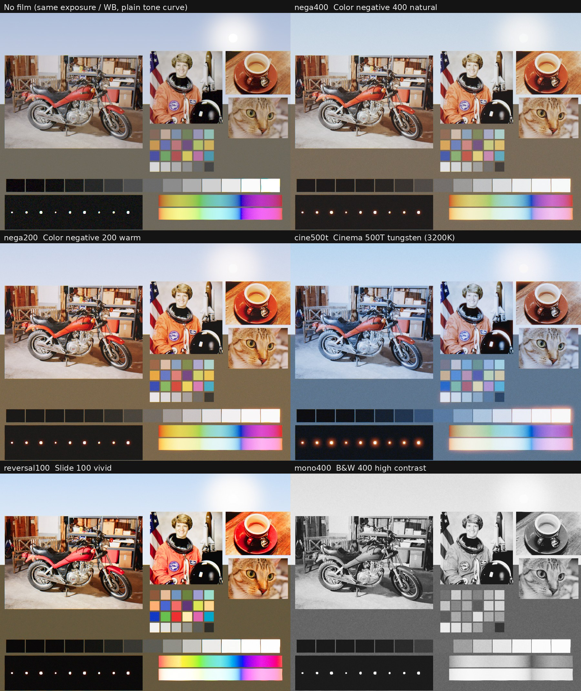

# FilmLab（Camera-movie）

Pixel の**純正カメラで撮った RAW（DNG）**を、画質を落とさずに**フィルムの質感**へ現像する個人用 Android アプリ。

- 撮影は純正 Pixel カメラ（HDR+ で合成された RAW を得るため）
- 現像は DNG から 32bit 浮動小数点で 1 回だけ:
  レンズ補正（GainMap / WarpRectilinear）→ デモザイク → DNG 準拠の色変換 → ネガ→プリントのフィルムモデル（粒子・ハレーション）
- 出力はフル解像度の JPEG（4:4:4・Display P3・EXIF 付き）を `Pictures/FilmLab` に保存
- 撮るだけで自動現像するモードあり

仕組みと技術的な障壁の調査は [docs/RESEARCH.md](docs/RESEARCH.md) を参照。

## インストール（Pixel 10）

1. GitHub の **Actions → Build APK** の最新の実行を開き、Artifacts の `FilmLab-apk` をダウンロードして展開する
2. `app-release.apk` を Pixel に入れてインストールする（「提供元不明のアプリ」を許可）
   - 署名鍵はリポジトリ内の固定の開発用鍵（`app/filmlab-dev.keystore`）なので、新しいビルドは上書きで更新できる
3. 初回起動で写真へのアクセスを「すべて許可」にする

## フィルムカメラ（FilmCam）

ホーム画面の **FilmCam** アイコン（FilmLab の「フィルムカメラ」ボタンからも開ける）は、自前のカメラ画面です。

- ファインダーに選んだ銘柄の見た目（色・階調・粒子）を **リアルタイム表示**（GPU で 3D LUT + 粒子）
  - 画面を押している間はフィルムなしの映像
- シャッターで RAW を連写（1 / 4 / 8 枚。ボタンで切替）→ 手ブレを位置合わせして合成 → DNG 化 → フル解像度でフィルム現像
  - 合成した DNG は `DCIM/FilmLab` に保存（FilmLab で別の銘柄に現像し直せる）、現像結果は `Pictures/FilmLab`
  - 複数枚のときは 1 段アンダーで撮ってハイライトを守り、合成でノイズを減らす
- 純正カメラの HDR+ は使えないため、画質は合成枚数と被写体の動きに左右される。最高画質を優先する場面は純正カメラ + FilmLab を使う

## 使い方（純正カメラ + FilmLab）

1. **Pixel カメラ側の設定**: 設定 → 詳細設定 → 「RAW / JPEG の管理」を **RAW + JPEG** にする
   （以後、`DCIM/Camera` に `PXL_…RAW-02.ORIGINAL.dng` が保存される）
2. FilmLab の「Pixel カメラで撮影」で純正カメラを起動して撮る（普段どおり電源ボタン 2 回押しで撮ってもよい）
3. FilmLab に戻ると最新の DNG が開く。フィルム銘柄とスライダーで調整する
   - プレビューを押している間は、Pixel 純正の仕上がり（DNG 埋め込みプレビュー）を表示する
   - スライダーの項目名を長押しすると既定値に戻る
4. 「フル解像度で保存」で `Pictures/FilmLab/PXL_…_<銘柄>.jpg` に保存される
5. 「自動現像」をオンにすると、それ以降に撮った DNG を現在の設定で自動的に現像して保存する
   - Android の省電力制御のため、実行が数十秒〜数分遅れることがある。気になる場合は FilmLab の電池設定を「制限なし」にする
   - 取りこぼしがあっても「未現像をまとめて現像」で後から処理できる



| 銘柄 | 性格 |
|---|---|
| カラーネガ 400 ナチュラル | 広いラチチュード、柔らかい階調、自然な肌色 |
| カラーネガ 200 ウォーム | 暖色・高彩度、細かい粒子 |
| シネマ 500T タングステン | 3200K バランス（昼光で青い）、強い赤のハレーション |
| リバーサル 100 ビビッド | 高コントラスト・高彩度、黒が締まる |
| モノクロ 400 ハイコントラスト | 粗めの粒子とエッジ |

## 開発

```
core/   画像処理エンジン（純 Kotlin/JVM。Android と PC の両方で動く）
  dng/     TIFF/DNG 解析、ロスレス JPEG(LJ92) デコーダ、Opcode（レンズ補正）
  raw/     デモザイク、DNG の色変換、帯処理の現像パイプライン、自動露出
  film/    フィルムモデル（特性曲線・層間効果・粒子・ハレーション）と銘柄
  output/  JPEG(4:4:4) エンコーダ、Display P3 ICC、EXIF
app/    Android アプリ（Views のみ・AndroidX 非依存）
tools/  検証用の合成 DNG 生成スクリプト
```

- APK のビルド: `./gradlew :app:assembleRelease`（Android SDK が必要。CI では GitHub Actions が自動でビルドする）
- エンジンのテスト: `./gradlew :core:test`
- PC 上での現像（チューニング用）:
  ```
  ./gradlew :core:installDist
  core/build/install/core/bin/core input.dng out.jpg --stock nega400 --ev 0.3
  core/build/install/core/bin/core input.dng out.jpg --all      # 全銘柄のプレビュー
  core/build/install/core/bin/core input.dng --info             # DNG の中身を表示
  ```
- 合成 DNG の生成: `python3 tools/make_test_dng.py out.dng --lj92 --comps 2`（numpy, Pillow, scikit-image が必要）
- Android SDK が無い環境での型チェック: `./gradlew -PandroidTypecheck :typecheck:compileKotlin`
